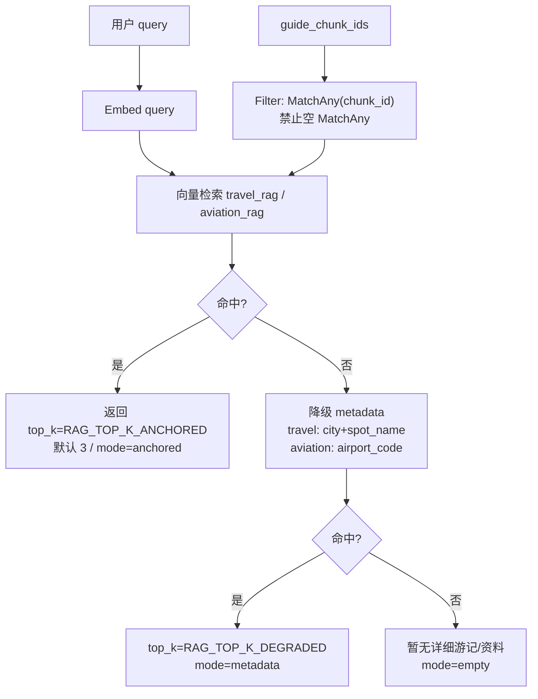
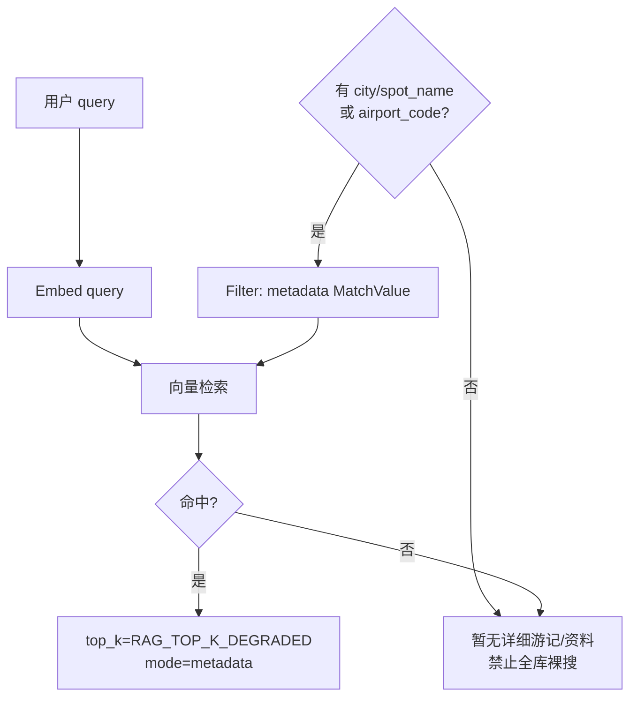
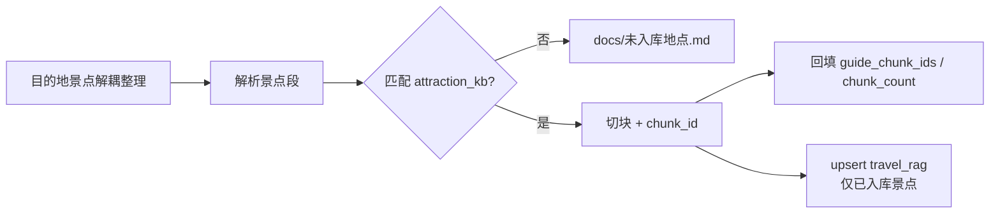

# P2：Qdrant 二次检索 + airport_kb / airline_kb

## 阶段划分

| 批次 | 内容 | 状态 |
|------|------|------|
| Batch 1 | Postgres `airport_kb`（基础信息）/ `airline_kb`（code stub）分表 | DONE（`scripts/init_aviation_kb.sql`） |
| Batch 2 | Qdrant `travel_rag` / `aviation_rag` + 检索工具（chunk_id 过滤 / 降级） | DONE（骨架） |
| Batch 3 | 切块编号 / embedding upsert / `guide_chunk_ids` 回填（先旅游语料） | IN PROGRESS |
| Batch 4 | 混合检索（BM25 + 向量 + RRF）与可选 rerank | TODO |

## 约定（已确认）

- Collection 隔离：`travel_rag` ≠ `aviation_rag`，跨领域不串。
- Point ID：Qdrant 仅支持 UUID/uint → 使用 `uuid5(ns, chunk_id)`；**payload.chunk_id** 为字符串主键字段，MatchAny 打这个字段。
- `guide_chunk_ids=[]`：**禁止**空过滤器；降级 `city` / `spot_name`（航司：`airport_code`）metadata；再无 →「暂无详细游记」。
- 有锚点时 `top_k=3`（`RAG_TOP_K_ANCHORED`）；降级默认 `RAG_TOP_K_DEGRADED=5`。
- Postgres：`attraction_kb` 管旅游名片；`airport_kb` 机场基础信息；`airline_kb` 航司 stub（先 code）。
- **未匹配到 `attraction_kb` 的语料景点：只进 `docs/未入库地点.md`，禁止 upsert Qdrant**；你补齐名片后再跑 ingest。

## Chunk 编号

格式：`chunk_{place_slug}_{nn}_{topic}`  

例：`chunk_djy_01_visitor_guide`、`chunk_djy_02_transport`、`chunk_djy_03_lodging`。

| 段首 | topic |
|------|--------|
| （整段合并概要，可选） | `visitor_guide` |
| 交通 | `transport` |
| 住宿 | `lodging` |
| 美食 | `food` |
| 小贴士 | `tips` |

- `place_slug`：优先取 KB id 中段（如 `spot_cd_djy_005` → `djy`）。
- 同一景点超长段按 `RAG_CHUNK_SIZE` / `RAG_CHUNK_OVERLAP` 再切，序号递增。
- 回填：`attraction_kb.payload.rag_links.guide_chunk_ids` + `chunk_count`。

## 检索流水线（两套）

上游先出名片（Postgres Top5）。是否带 `guide_chunk_ids` 决定走哪条路径。

### A. 锚定路径（`guide_chunk_ids` 非空）



- 锚点集合通常很小（≤10）：Batch 4 的 **rerank 可关**（候选池已窄，省时延）。
- 与「query 是否提到安检」无关：意图清晰仍可检索；关 rerank 只看**候选数量**。

### B. 降级路径（`guide_chunk_ids` 为空）



### Batch 4（规划，未实现）

在过滤后的子集上：

1. BM25 top20 ∥ 向量 top20  
2. RRF（k=60）→ 粗排 top15  
3. 可选 `bge-reranker-large` → 最终 top3~5  
4. 规则：候选 ≤ `RAG_RERANK_MIN_CANDIDATES`（建议 8～10）时跳过 rerank  

LLM 生成温度建议 0.1～0.2（只影响生成，不提高检索精度）。

## 写入流水线（Batch 3）



```powershell
# 1) 确保 Collection
docker compose up -d qdrant
python scripts/ensure_qdrant_collections.py

# 2) 匹配 + 未入库清单（不写向量）
python scripts/match_dest_attractions.py

# 3) 你先把「未入库地点」补进 attraction_kb 后，再：
python scripts/ingest_travel_rag.py --upsert-qdrant
# 仅回填 Postgres、不写向量：
python scripts/ingest_travel_rag.py --pg-only
```

## 本批文件

| 路径 | 作用 |
|------|------|
| `scripts/init_aviation_kb.sql` | airport_kb / airport_services / airline_kb DDL |
| `app/tools/airport_service.py` | 工具 `search_airport_service`（分查拼 Markdown） |
| `docker-compose.yml` → `qdrant` | 向量库服务 |
| `app/rag/search.py` | `search_travel_rag` / `search_aviation_rag` |
| `app/rag/collections.py` | 建 Collection + payload 索引 |
| `app/rag/chunking.py` | 切块 + chunk_id |
| `app/rag/upsert.py` | embedding upsert |
| `app/rag/dest_corpus.py` | 解析目的地解耦语料 |
| `scripts/ensure_qdrant_collections.py` | 一键确保两个 Collection |
| `scripts/match_dest_attractions.py` | 匹配 KB + 写未入库清单 |
| `scripts/ingest_travel_rag.py` | 回填 PG + 可选 upsert |
| `docs/未入库地点.md` | 语料有、库中无 → 先补库再灌向量 |
| `data/knowledge/_dest_attractions_raw.txt` | docx 抽取正文 |
| `data/knowledge/_dest_match_report.json` | 匹配报告 |
